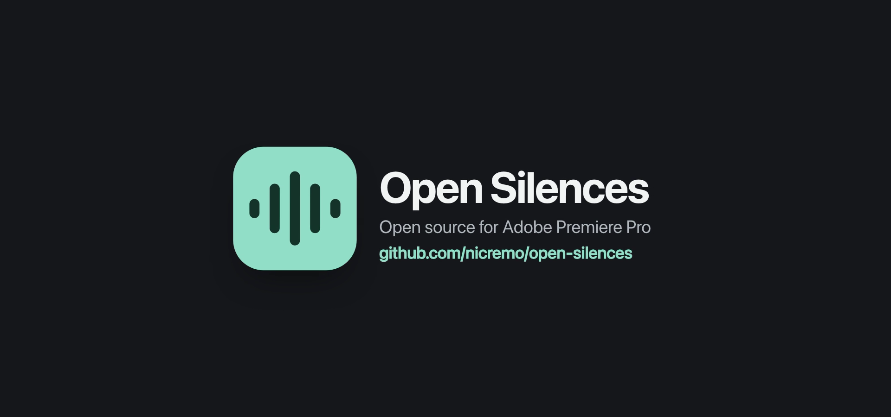
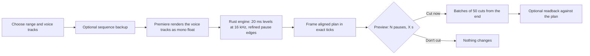

<p align="center">
  <a href="https://github.com/nicremo/open-silences/releases/latest"></a>
</p>

<h1 align="center">Cut the silence. Keep your backup.</h1>

<p align="center">
  <strong>Open Silences is a free, open source silence remover for Adobe Premiere Pro.</strong><br />
  Pick a range and your voice track, check the preview, click once.<br />
  A local Rust engine finds the pauses, Premiere closes the gaps, and a verified backup of your sequence comes first.
</p>

<p align="center">
  <a href="LICENSE"></a>
  <a href="https://github.com/nicremo/open-silences/actions/workflows/checks.yml"></a>
  <a href="package.json"></a>
  
  
  
</p>

<p align="center">
  <a href="https://opensilences.nicremo.de"><strong>Website</strong></a> ·
  <a href="#watch">Watch</a> ·
  <a href="#why-open-silences">Why</a> ·
  <a href="#get-started">Get started</a> ·
  <a href="#how-it-works">How it works</a> ·
  <a href="#settings">Settings</a> ·
  <a href="#limits">Limits</a> ·
  <a href="CONTRIBUTING.md">Contribute</a>
</p>

## Watch

<p align="center">
  <a href="https://github.com/nicremo/open-silences/releases/latest"></a>
</p>

<p align="center"><sub>A 16 second launch film. The full quality MP4 with sound is attached to the <a href="https://github.com/nicremo/open-silences/releases/latest">latest release</a>. Panel texts are the real ones, the numbers are an example.</sub></p>

## Why Open Silences

Removing pauses from a talking head video should take one click, not an afternoon, and it should never risk your edit.

- **Free and open source.** MIT licensed. No subscription, no account, no feature gate.
- **Local.** Your audio never leaves your Mac. Premiere renders the selected voice tracks, a Rust engine reads them directly.
- **A backup before every run, if you want it.** Open Silences duplicates your sequence into a project bin and verifies the copy before it cuts. The backup can be switched off for speed.
- **See it before it happens.** The panel shows how many pauses it found and how much time goes away. Nothing is cut until you click **Cut now**.
- **Precise edges.** Every cut edge is placed between the 20 ms level values where speech fades, then rounded inwards to whole frames, so a cut never reaches into speech.
- **Whole selection or speech clips only.** By default every track is cut at each pause inside the range, gaps between clips included. "Under speech clips only" cuts just where a clip lies on a chosen speech track.
- **An automatic threshold.** "Estimate level automatically" splits the levels into room tone and speech and suggests the top of the room tone.
- **Fast cutting.** Cuts run in batches of 50 from the end of the timeline. Each cut is one extract between in and out points, while the timeline shows frame numbers. That is why every frame rate works.
- **Verified result.** After the cut every clip position and media reference is read back and compared with the plan. This check can be switched off too.

Open Silences is an independent project. It is not affiliated with or endorsed by Adobe.

## Get started

Open Silences is an alpha for **Premiere Pro 26.5 on Apple Silicon Macs**. The extension is not signed yet, so Premiere needs its developer mode for unsigned extensions once.

1. Download `open-silences-<version>-macos-arm64.zip` from the [latest release](https://github.com/nicremo/open-silences/releases/latest) and unzip it.
2. Allow unsigned extensions for CEP 11 (one time, then restart Premiere):

   ```bash
   defaults write com.adobe.CSXS.11 PlayerDebugMode 1
   ```

3. Copy the `open-silences` folder into your extensions folder and clear the download quarantine, so macOS lets the panel start its unsigned engine:

   ```bash
   cp -R open-silences "$HOME/Library/Application Support/Adobe/CEP/extensions/"
   xattr -dr com.apple.quarantine "$HOME/Library/Application Support/Adobe/CEP/extensions/open-silences"
   ```

4. Open Premiere Pro and choose **Window > Extensions > Open Silences (Alpha)**.

To update, close the panel, replace the folder and open the panel again.

### Agent CLI

Open Silences can also be driven from a terminal or by an AI agent. An invisible bridge starts with Premiere, and the `open-silences` command runs the same protected workflow as the panel:

```bash
open-silences preview --json
open-silences cut --yes --json
```

Defaults: entire timeline, track A1, -45 dB and the Standard pacing. Setup and all options: [docs/CLI.md](docs/CLI.md).

### Build from source

Install the Rust toolchain and Node.js 22 or later.

```bash
git clone https://github.com/nicremo/open-silences.git
cd open-silences
npm run build
```

The package is written to `premiere-plugin/dist/open-silences/`. The build installs nothing and changes no Premiere setting.

## How it works



The detector is specified in [docs/DETECTION.md](docs/DETECTION.md): levels strictly below the threshold are quiet, pause edges move between the level values by energy, the air comes off before the minimum pause is checked, and short speech between two cuts joins them. The planner rounds every cut inwards to whole frames, so a cut never reaches into speech. The architecture is described in [docs/ARCHITECTURE.md](docs/ARCHITECTURE.md).

## Settings

The panel speaks English, Spanish and German. It asks for your language the first time it opens, and the globe menu at the top changes it any time. All settings stay on your computer.

| Setting | Default | Meaning |
| --- | --- | --- |
| Noise floor | -45 dB | Audio strictly below this level counts as silence. "Estimate level automatically" suggests a value for your recording. |
| Silence from | 160 ms | Shortest cut, measured after the air is kept. |
| Speech from | 160 ms | Speech between two cuts that is shorter than this, air included, is cut with them. |
| Air before speech | 160 ms | Audio kept before speech starts. |
| Air after speech | 160 ms | Audio kept after speech ends. |
| Space between cuts | 0 ms (off) | Where cuts lie closer together, the longest of them stays. |
| What gets cut | Whole selection | Every track in the range, or only under speech clips. |
| Protection | Backup and readback on | A backup before the cut, a second render right before it and a readback after it can each be switched on or off. |

Pacing presets from **Standard** to **Very tight** set the four timing values at once: Standard keeps 160 ms, the others set all four to 500, 350, 200, 100 or 50 ms.

## Limits

| Area | Current scope |
| --- | --- |
| Operating system | macOS on Apple Silicon |
| Premiere Pro | 26.5.x |
| Frame rates | Every rate Premiere reports; cut points are frame numbers |
| Integration | CEP panel and ExtendScript; native cutting uses the undocumented QE API |
| Timeline | A transition inside a pause and locked content that a ripple would move stop that pause instead of being guessed |

Audio export and every batch of cuts block Premiere for a moment. A cancel takes effect between two batches. A failed cut may leave a partly edited sequence; the backup, when switched on, is there to restore it. The batched cut path is new in this version. Windows is not supported yet. More detail in the [panel README](premiere-plugin/README.md) (German).

## Privacy

No network access is needed. Open Silences keeps run evidence (the rendered WAV, the snapshot and the engine output) in your temporary folder under `open-silences-evidence` so a failed run can be debugged. Delete it whenever you like.

## Verify

```bash
cargo test --release --locked --manifest-path premiere-plugin/engine/Cargo.toml
cargo clippy --locked --all-targets --manifest-path premiere-plugin/engine/Cargo.toml -- -D warnings
npm test
```

FFmpeg is needed for the synthetic test fixtures. CI runs these checks on Linux and macOS. Passing CI does not prove Premiere compatibility; that needs a live test in Premiere.

## Project layout

| Path | Purpose |
| --- | --- |
| `premiere-plugin/engine/` | Rust engine: PCM reader, block levels, pause detector, cut planner, CLI |
| `premiere-plugin/panel/` | CEP panel, workflow and ExtendScript host adapter |
| `premiere-plugin/test/` | Panel, wire, package and engine protocol tests |
| `premiere-plugin/install/` | Package builder |
| `docs/` | Detector specification, architecture, provenance, release checklist |

## Contributing and license

Contributions are welcome. Read [CONTRIBUTING.md](CONTRIBUTING.md) first; host changes need a test with synthetic media in Premiere.

Open Silences is released under the [MIT license](LICENSE). Third-party components keep their own terms: the Adobe CSInterface bridge ships under the Adobe General SDK License, JSON2 is in the public domain. See [THIRD-PARTY.md](THIRD-PARTY.md). Adobe and Premiere Pro are trademarks of Adobe.

Made by [Fabian Bitzer](https://github.com/nicremo).
