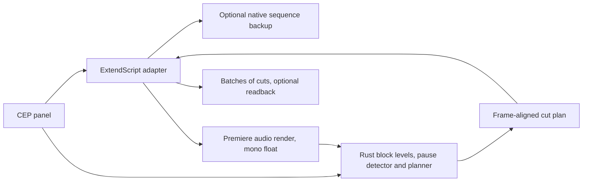

# Architecture

The CEP panel owns the user workflow and launches the local Rust engine. Its copy lives in `panel/js/i18n.js` (English, Spanish, German); everything below the panel, host replies and engine errors, is written in English. ExtendScript reads and changes Premiere state. The engine receives explicit snapshots and produces plans using integer tick strings.

The pause detector is specified in `docs/DETECTION.md` and implemented in the engine from that document. When a plan is applied, the ExtendScript adapter indexes the plan and the timeline once per run instead of rescanning both for every cut.

Cuts run in batches of up to 50 cuts per host call, from the end of the timeline towards the start, so a ripple never moves a position a later batch still needs. While a batch runs the sequence shows frame numbers, so every cut point is a plain frame count and no timecode flavour such as drop frame is parsed. Each cut is one extract: in and out points mark the range and Premiere's extract removes it from every targeted track and closes the gap in one step, also across clip boundaries. Every unlocked track is targeted for the batch. The in and out points are checked on the first and last cut of a batch, the sequence length after every cut. Display format, targeting and in and out points the user had set are restored before the call returns, also after a failure. Without extract on the host every piece is razored and removed, with one ripple per piece on sync locked tracks. The previous single call apply (`OS_applyPlan`) stays available.

The workflow rechecks identity and state before analysis and mutation. An optional backup is made before the analysis. The chosen audio tracks are exported as a mono WAV with 32 bit float samples at the sequence rate, so no resampling filter touches the mix; the engine measures it at 16 kHz by keeping every n-th sample. The other audio tracks are muted for the export and restored afterwards, and Premiere's own 48 kHz preset is the fallback. An optional second export checks the audio mix right before the cut. An optional final readback compares every surviving clip with the plan, its source range for clips at normal speed, and proves the backup unchanged.

The adapter embeds JSON2 because a fresh ExtendScript context can lack JSON. Startup cannot depend on another extension supplying it.

The native cut path uses the undocumented QE API, which limits supported Premiere versions. Host mutation is not transactional. On failure, keep the backup when there is one and report the incomplete operation; do not retry a mutation automatically. A cancel takes effect between two batches.

## Agent CLI

The package contains a second, invisible CEP extension (`de.fabian.open-silences.bridge`). It starts when Premiere activates, loads the same ExtendScript adapter and serves a file queue in `~/Library/Application Support/open-silences/bridge/`. A command names one of the seven host calls; raw ExtendScript is rejected. Commands are claimed by an atomic rename, run one at a time, and answered with the unchanged host text. Commands older than two minutes are refused.

The CLI in `cli/` runs `createWorkflow` from the panel with this queue as host and the bundled engine as engine. `--yes` replaces the confirmation click. A call without a reply is reported as an unknown outcome and never retried. Usage: `docs/CLI.md`.
